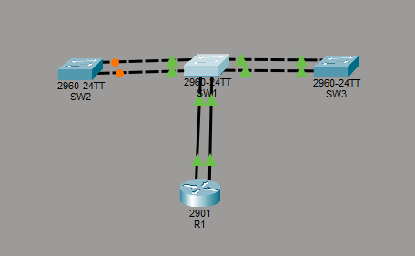
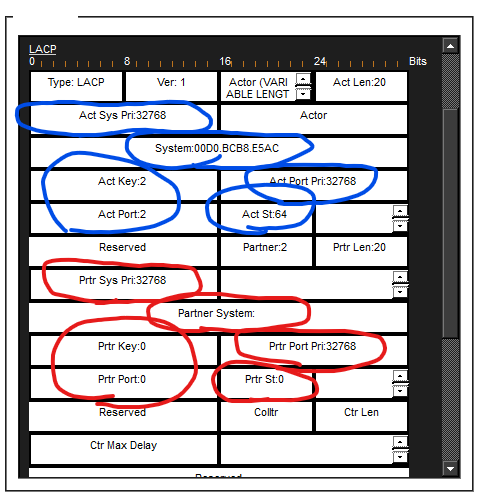

Отчет по лабораторной работе №5
Тема: LAG /  EtherChannel.
**Выполнил:** Барков М. Г., гр. 409 

## Топология



## Ответы на вопросы

1. Потому что на обоих концах соединительных линий не настроена агрегация каналов (EtherChannel) и не согласован протокол. По умолчанию физические порты коммутаторов Cisco работают в режиме доступа или динамическом режиме, и когда несколько линий подключены между двумя коммутаторами, если не настроен EtherChannel, протокол связующего дерева (STP) заблокирует избыточные порты для предотвращения петли. В данном случае интерфейсы между SW1 и SW2, SW1 и SW3 должны быть объединены вручную или динамически, чтобы стать логическим каналом и одновременно передавать трафик.
2.
```text
SW1#show etherchannel summary 
Flags:  D - down        P - in port-channel
        I - stand-alone s - suspended
        H - Hot-standby (LACP only)
        R - Layer3      S - Layer2
        U - in use      f - failed to allocate aggregator
        u - unsuitable for bundling
        w - waiting to be aggregated
        d - default port


Number of channel-groups in use: 1
Number of aggregators:           1

Group  Port-channel  Protocol    Ports
------+-------------+-----------+----------------------------------------------

1      Po1(SD)           -      Gig0/1(D) Gig0/2(D) 
```
```text
SW1#show etherchannel port-channel 
                Channel-group listing:
                ----------------------

Group: 1
----------
                Port-channels in the group:
                ---------------------------

Port-channel: Po1
------------

Age of the Port-channel   = 00d:00h:01m:54s
Logical slot/port   = 2/1       Number of ports = 0
GC                  = 0x00000000      HotStandBy port = null
Port state          = Port-channel 
Protocol            =   -
Port Security       = Disabled
```
```text
SW1#show interfaces Po1
Port-channel1 is down, line protocol is down (notconnect)
  Hardware is EtherChannel, address is 0002.4a1c.9382 (bia 0002.4a1c.9382)
  MTU 1500 bytes, BW 100000 Kbit, DLY 100 usec, 
     reliability 255/255, txload 1/255, rxload 1/255
  Encapsulation ARPA, loopback not set
  Keepalive set (10 sec)
  Auto-duplex, Auto-speed
  input flow-control is off, output flow-control is off
  ARP type: ARPA, ARP Timeout 04:00:00
  Last input 00:00:08, output 00:00:05, output hang never
  Last clearing of "show interface" counters never
  Input queue: 0/75/0/0 (size/max/drops/flushes); Total output drops: 0
  Queueing strategy: fifo
  Output queue :0/40 (size/max)
  5 minute input rate 0 bits/sec, 0 packets/sec
  5 minute output rate 0 bits/sec, 0 packets/sec
     956 packets input, 193351 bytes, 0 no buffer
     Received 956 broadcasts, 0 runts, 0 giants, 0 throttles
     0 input errors, 0 CRC, 0 frame, 0 overrun, 0 ignored, 0 abort
     0 watchdog, 0 multicast, 0 pause input
     0 input packets with dribble condition detected
     2357 packets output, 263570 bytes, 0 underruns
 ```
Состояние: SU указывает на то, что это уровень 2 и канал используется; дочерние порты имеют флаг P (bundled), что означает, что они успешно объединены в канал.

Готов к передаче: нет - на R1 агрегация не настроена, сквозного соединения нет.

Проблемы: Да — режим on не согласует параметры с другой стороной: порты могут быть up, но трафик не пройдёт.

3. 
```text
SW1#show etherchannel summary 
Flags:  D - down        P - in port-channel
        I - stand-alone s - suspended
        H - Hot-standby (LACP only)
        R - Layer3      S - Layer2
        U - in use      f - failed to allocate aggregator
        u - unsuitable for bundling
        w - waiting to be aggregated
        d - default port


Number of channel-groups in use: 2
Number of aggregators:           2

Group  Port-channel  Protocol    Ports
------+-------------+-----------+----------------------------------------------

1      Po1(SU)           -      Gig0/1(P) Gig0/2(P) 
2      Po2(SD)           LACP   Fa0/1(I) Fa0/2(I) 
```
```text
SW1#show etherchannel port-channel 
                Channel-group listing:
                ----------------------

Group: 1
----------
                Port-channels in the group:
                ---------------------------

Port-channel: Po1
------------

Age of the Port-channel   = 00d:00h:19m:39s
Logical slot/port   = 2/1       Number of ports = 2
GC                  = 0x00000000      HotStandBy port = null
Port state          = Port-channel 
Protocol            =   -
Port Security       = Disabled

Ports in the Port-channel:

Index   Load   Port     EC state        No of bits
------+------+------+------------------+-----------
  0     00     Gig0/2   On                 0
  0     00     Gig0/1   On                 0
Time since last port bundled:    00d:00h:03m:24s    Gig0/1
Group: 2
----------
                Port-channels in the group:
                ---------------------------

Port-channel: Po2    (Primary Aggregator)
------------

Age of the Port-channel   = 00d:00h:02m:33s
Logical slot/port   = 2/2       Number of ports = 0
GC                  = 0x00000000      HotStandBy port = null
Port state          = Port-channel 
Protocol            =   LACP
Port Security       = Disabled
```
```text
SW1#show interfaces Po2
Port-channel2 is down, line protocol is down (notconnect)
  Hardware is EtherChannel, address is 0009.7c54.bde8 (bia 0009.7c54.bde8)
  MTU 1500 bytes, BW 100000 Kbit, DLY 100 usec, 
     reliability 255/255, txload 1/255, rxload 1/255
  Encapsulation ARPA, loopback not set
  Keepalive set (10 sec)
  Auto-duplex, Auto-speed
  input flow-control is off, output flow-control is off
  ARP type: ARPA, ARP Timeout 04:00:00
  Last input 00:00:08, output 00:00:05, output hang never
  Last clearing of "show interface" counters never
  Input queue: 0/75/0/0 (size/max/drops/flushes); Total output drops: 0
  Queueing strategy: fifo
  Output queue :0/40 (size/max)
  5 minute input rate 0 bits/sec, 0 packets/sec
  5 minute output rate 0 bits/sec, 0 packets/sec
     956 packets input, 193351 bytes, 0 no buffer
     Received 956 broadcasts, 0 runts, 0 giants, 0 throttles
     0 input errors, 0 CRC, 0 frame, 0 overrun, 0 ignored, 0 abort
     0 watchdog, 0 multicast, 0 pause input
     0 input packets with dribble condition detected
     2357 packets output, 263570 bytes, 0 underruns
     0 output errors, 0 collisions, 10 interface resets
     0 babbles, 0 late collision, 0 deferred
     0 lost carrier, 0 no carrier
     0 output buffer failures, 0 output buffers swapped out
```
Состояние: SU, канал используется.

Состояние дочерних портов: P, порты объединены.

Готов ли к передаче трафика: Нет. Хотя локальная сторона активна, на противоположном конце SW2 ещё не настроен LACP, поэтому согласование LACP не завершено, и канал не может нормально пересылать данные.

4. 



Когда SW1 (режим active) впервые отправляет LACPDU, он ещё не получил информацию о партнёре от противоположного конца. В соответствии с определением протокола LACP, поле Partner в исходном сообщении заполняется нулями или значениями по умолчанию, что означает «партнёр неизвестен». Только после того, как SW2 ответит LACPDU, SW1 сможет получить реальную информацию о системе и портах партнёра из полученного сообщения.

5. Нет, не помешает. Номер LAG (Channel-group) — это локальный идентификатор, он нужен только самому коммутатору для управления портами. В пакетах LACP этот номер не передается.
```text
SW2#show etherchannel port-channel 
                Channel-group listing:
                ----------------------

Group: 1
----------
                Port-channels in the group:
                ---------------------------

Port-channel: Po1    (Primary Aggregator)
------------

Age of the Port-channel   = 00d:00h:00m:18s
Logical slot/port   = 2/1       Number of ports = 2
GC                  = 0x00000000      HotStandBy port = null
Port state          = Port-channel 
Protocol            =   LACP
Port Security       = Disabled

Ports in the Port-channel:

Index   Load   Port     EC state        No of bits
------+------+------+------------------+-----------
  0     00     Fa0/2    Passive            0
  0     00     Fa0/1    Passive            0
Time since last port bundled:    00d:00h:00m:15s    Fa0/1
```
6. 
```text
SW1#show etherchannel summary 
Flags:  D - down        P - in port-channel
        I - stand-alone s - suspended
        H - Hot-standby (LACP only)
        R - Layer3      S - Layer2
        U - in use      f - failed to allocate aggregator
        u - unsuitable for bundling
        w - waiting to be aggregated
        d - default port


Number of channel-groups in use: 3
Number of aggregators:           3

Group  Port-channel  Protocol    Ports
------+-------------+-----------+----------------------------------------------

1      Po1(SU)           -      Gig0/1(P) Gig0/2(P) 
2      Po2(SU)           LACP   Fa0/1(P) Fa0/2(P) 
3      Po3(SU)           PAgP   Fa0/3(P) Fa0/4(P) 
```
```text
SW1#show etherchannel port-channel 
                Channel-group listing:
                ----------------------

Group: 1
----------
                Port-channels in the group:
                ---------------------------

Port-channel: Po1
------------

Age of the Port-channel   = 00d:00h:33m:22s
Logical slot/port   = 2/1       Number of ports = 2
GC                  = 0x00000000      HotStandBy port = null
Port state          = Port-channel 
Protocol            =   -
Port Security       = Disabled

Ports in the Port-channel:

Index   Load   Port     EC state        No of bits
------+------+------+------------------+-----------
  0     00     Gig0/2   On                 0
  0     00     Gig0/1   On                 0
Time since last port bundled:    00d:00h:17m:08s    Gig0/1
Group: 2
----------
                Port-channels in the group:
                ---------------------------

Port-channel: Po2    (Primary Aggregator)
------------

Age of the Port-channel   = 00d:00h:16m:17s
Logical slot/port   = 2/2       Number of ports = 2
GC                  = 0x00000000      HotStandBy port = null
Port state          = Port-channel 
Protocol            =   LACP
Port Security       = Disabled

Ports in the Port-channel:

Index   Load   Port     EC state        No of bits
------+------+------+------------------+-----------
  0     00     Fa0/1    Active             0
  0     00     Fa0/2    Active             0
Time since last port bundled:    00d:00h:07m:33s    Fa0/2
Group: 3
----------
                Port-channels in the group:
                ---------------------------

Port-channel: Po3
------------

Age of the Port-channel   = 00d:00h:02m:04s
Logical slot/port   = 2/3       Number of ports = 2
GC                  = 0x00000000      HotStandBy port = null
Port state          = Port-channel 
Protocol            =   PAgP
Port Security       = Disabled

Ports in the Port-channel:

Index   Load   Port     EC state        No of bits
------+------+------+------------------+-----------
  0     00     Fa0/3    Desirable-Sl       0
  0     00     Fa0/4    Desirable-Sl       0
Time since last port bundled:    00d:00h:00m:59s    Fa0/4
```
7. 
```text
SW1#show running-config
Building configuration...

Current configuration : 1368 bytes
!
version 15.0
no service timestamps log datetime msec
no service timestamps debug datetime msec
no service password-encryption
!
hostname SW1
!
!
!
no ip domain-lookup
!
!
!
spanning-tree mode pvst
spanning-tree extend system-id
!
interface Port-channel1
!
interface Port-channel2
!
interface Port-channel3
!
interface FastEthernet0/1
 channel-group 2 mode active
!
interface FastEthernet0/2
 channel-group 2 mode active
!
interface FastEthernet0/3
 channel-group 3 mode desirable
!
interface FastEthernet0/4
 channel-group 3 mode desirable
!
interface FastEthernet0/5
!
interface FastEthernet0/6
!
interface FastEthernet0/7
!
interface FastEthernet0/8
!
interface FastEthernet0/9
!
interface FastEthernet0/10
!
interface FastEthernet0/11
!
interface FastEthernet0/12
!
interface FastEthernet0/13
!
interface FastEthernet0/14
!
interface FastEthernet0/15
!
interface FastEthernet0/16
!
interface FastEthernet0/17
!
interface FastEthernet0/18
!
interface FastEthernet0/19
!
interface FastEthernet0/20
!
interface FastEthernet0/21
!
interface FastEthernet0/22
!
interface FastEthernet0/23
!
interface FastEthernet0/24
!
interface GigabitEthernet0/1
 channel-group 1 mode on
!
interface GigabitEthernet0/2
 channel-group 1 mode on
!
interface Vlan1
 no ip address
 shutdown
!
!
!
!
line con 0
 logging synchronous
!
line vty 0 4
 login
line vty 5 15
 login
!
!
!
!
end
 ```
 8.
 ```text
 SW1#show running-config 
Building configuration...

Current configuration : 1539 bytes
!
version 15.0
no service timestamps log datetime msec
no service timestamps debug datetime msec
no service password-encryption
!
hostname SW1
!
!
!
no ip domain-lookup
!
!
!
spanning-tree mode pvst
spanning-tree extend system-id
!
interface Port-channel1
!
interface Port-channel2
 switchport mode trunk
 switchport nonegotiate
 spanning-tree portfast trunk
!
interface Port-channel3
!
interface FastEthernet0/1
 switchport mode trunk
 switchport nonegotiate
 channel-group 2 mode active
!
interface FastEthernet0/2
 switchport mode trunk
 switchport nonegotiate
 channel-group 2 mode active
!
interface FastEthernet0/3
 channel-group 3 mode desirable
!
interface FastEthernet0/4
 channel-group 3 mode desirable
!
interface FastEthernet0/5
!
interface FastEthernet0/6
!
interface FastEthernet0/7
!
interface FastEthernet0/8
!
interface FastEthernet0/9
!
interface FastEthernet0/10
!
interface FastEthernet0/11
!
interface FastEthernet0/12
!
interface FastEthernet0/13
!
interface FastEthernet0/14
!
interface FastEthernet0/15
!
interface FastEthernet0/16
!
interface FastEthernet0/17
!
interface FastEthernet0/18
!
interface FastEthernet0/19
!
interface FastEthernet0/20
!
interface FastEthernet0/21
!
interface FastEthernet0/22
!
interface FastEthernet0/23
!
interface FastEthernet0/24
!
interface GigabitEthernet0/1
 channel-group 1 mode on
!
interface GigabitEthernet0/2
 channel-group 1 mode on
!
interface Vlan1
 no ip address
 shutdown
!
!
!
!
line con 0
 logging synchronous
!
line vty 0 4
 login
line vty 5 15
 login
!
!
!
!
end
```
Port-channel2 из динамического режима (dynamic auto) изменён на принудительный trunk (switchport mode trunk). Добавлена команда switchport nonegotiate для отключения согласования DTP и предотвращения отправки кадров DTP на канале. Добавлена команда spanning-tree portfast trunk для включения PortFast на trunk-интерфейсе, чтобы пропустить прослушивание и изучение STP при подключении и ускорить переход в состояние пересылки.

9. На коммутаторе SW1 по умолчанию используется алгоритм балансировки по MAC-адресу источника — src-mac.

Если большая часть трафика идёт от R1, и используется алгоритм на основе src-mac, то весь трафик от одного и того же MAC-адреса R1 будет фиксированно распределяться на один и тот же физический порт в канале, что приведёт к перегрузке этого порта, в то время как другой порт будет простаивать, что не позволит достичь цели балансировки нагрузки.

10. Следует изменить на dst-ip (на основе IP-адреса назначения)

Поскольку трафик в основном поступает от R1 (один источник), использование src-mac или src-ip вызовет проблему поляризации. Использование dst-ip позволит распределять трафик, направленный к разным IP-адресам назначения, по разным физическим портам.
```text
SW1#show etherchannel load-balance
EtherChannel Load-Balancing Operational State (dst-ip):
Non-IP: Destination MAC address
  IPv4: Destination IP address
  IPv6: Destination IP address
```

